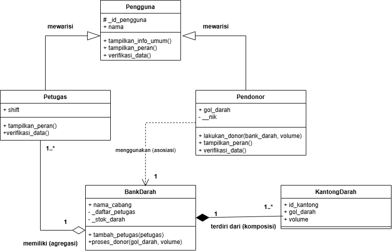
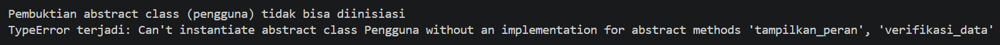
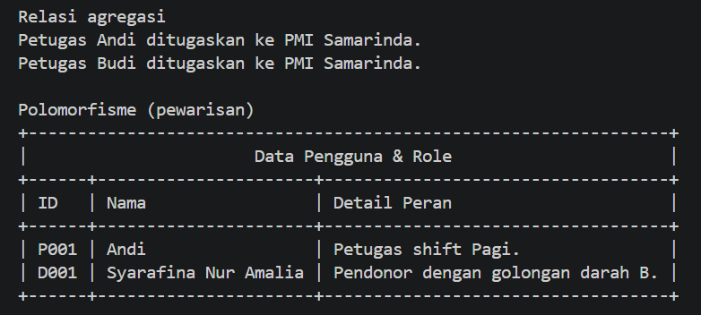
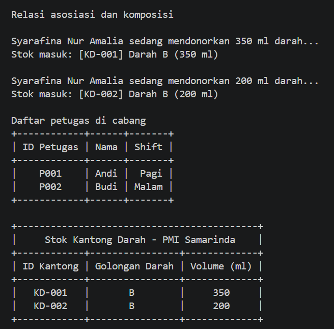
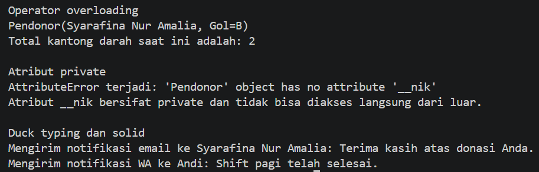

# Sistem Manajemen Donor Darah pada Bank Darah Mulawarman

Program berbasis Object-Oriented Programming (OOP) menggunakan Python untuk menyimulasikan sistem pengelolaan pendonor, penugasan petugas, dan pencatatan stok kantong darah di fasilitas penyedia kesehatan.

## Struktur Program

| File | Isi |
| --- | --- |
| `pengguna.py` | Abstract class `Pengguna` (ABC) |
| `petugas.py` | Subclass `Petugas` |
| `pendonor.py` | Subclass `Pendonor` |
| `bank_darah.py` | Kelas `BankDarah` (agregasi petugas, komposisi kantong darah) |
| `kantong_darah.py` | Kelas `KantongDarah` |
| `notifikasi.py` | `NotifikasiEmail`, `NotifikasiWA`, dan fungsi `kirim_notifikasi_sistem()` |
| `main.py` | Program utama / demonstrasi seluruh konsep |

**Cara menjalankan:**

```bash
pip install -r requirements.txt   # library prettytable
python main.py
```

## 1. Relasi UML (Class Diagram)



### a. Asosiasi (`Pendonor` → `BankDarah`)

`Pendonor` "menggunakan" `BankDarah`: objek `BankDarah` dilewatkan sebagai parameter pada method `lakukan_donor()`, lalu dipakai untuk memanggil `proses_donor()`. Dipilih asosiasi karena keduanya objek yang berdiri sendiri; `Pendonor` tidak menyimpan maupun memiliki `BankDarah`.

```python
# pendonor.py
def lakukan_donor(self, bank_darah, volume):
    print(f"\n{self.nama} sedang mendonorkan {volume} ml darah...")
    bank_darah.proses_donor(self.gol_darah, volume)   # Asosiasi
```

### b. Agregasi (`BankDarah` ◇— `Petugas`)

`BankDarah` memiliki daftar `Petugas`, tetapi objek `Petugas` dibuat di luar (di `main.py`) lalu dimasukkan lewat `tambah_petugas()`. Dipilih **agregasi** karena petugas tetap hidup walaupun `BankDarah` ditutup atau dihapus (misalnya bisa dipindah ke cabang lain), jadi siklus hidupnya tidak terikat pada `BankDarah`.

```python
# bank_darah.py
self._daftar_petugas = []              # penampung agregasi

def tambah_petugas(self, petugas):
    if isinstance(petugas, Petugas):
        self._daftar_petugas.append(petugas)   # objek dari luar
```

```python
# main.py
petugas1 = Petugas("P001", "Andi", "Pagi")                  # dibuat mandiri
bank_darah_mulawarman.tambah_petugas(petugas1)              # lalu dimasukkan
```

### c. Komposisi (`BankDarah` ◆— `KantongDarah`)

`BankDarah` terdiri dari `KantongDarah`, dan objek `KantongDarah` dibuat langsung di dalam `proses_donor()` lalu disimpan di atribut privat `_stok_darah`. Dipilih **komposisi** (bukan agregasi) karena kantong darah tidak punya arti di luar bank darah yang menyimpannya dan tidak pernah dibuat dari luar; jika `BankDarah` musnah, seluruh `KantongDarah`-nya ikut musnah.

```python
# bank_darah.py
def proses_donor(self, gol_darah, volume):
    id_baru = f"KD-{len(self._stok_darah) + 1:03d}"
    kantong = KantongDarah(id_baru, gol_darah, volume)   # dibuat DI DALAM BankDarah
    self._stok_darah.append(kantong)
```

> **Agregasi vs komposisi:** `Petugas` dibuat *di luar* dan hanya "dipinjam" oleh `BankDarah` (agregasi), sedangkan `KantongDarah` dibuat *di dalam* dan dimiliki penuh oleh `BankDarah` (komposisi).

## 2. Penerapan Abstraksi

* **Abstract class:** `Pengguna(ABC)` di `pengguna.py`.
* **Abstract method (2):** `tampilkan_peran()` dan `verifikasi_data()`, dengan `@abstractmethod`.
* **Subclass yang mengimplementasikan keduanya:** `Petugas` dan `Pendonor`.
* **Method konkret:** `tampilkan_info_umum()` di `Pengguna`, dipakai bersama oleh `Petugas` dan `Pendonor` tanpa di-override (dipanggil lewat loop di `main.py`).
* **Inheritance:** kedua subclass memakai `super().__init__(id_pengguna, nama)`, punya atribut unik (`shift` pada `Petugas`; `gol_darah` dan `__nik` pada `Pendonor`), atribut **protected** `_id_pengguna`, dan atribut **private** `__nik`.
* **Bukti abstract class tidak bisa diinstansiasi:** `Pengguna("U000", "Anonim")` dibungkus `try-except TypeError` di `main.py` (lihat screenshot pada bagian 4).

```python
# pengguna.py
from abc import ABC, abstractmethod

class Pengguna(ABC):
    def __init__(self, id_pengguna, nama):
        self._id_pengguna = id_pengguna      # Protected
        self.nama = nama

    def tampilkan_info_umum(self):           # Method konkret
        print(f"ID: {self._id_pengguna} | Nama: {self.nama}")

    @abstractmethod
    def tampilkan_peran(self):               # Abstract method 1
        pass

    @abstractmethod
    def verifikasi_data(self):               # Abstract method 2
        pass
```

```python
# pendonor.py
class Pendonor(Pengguna):
    def __init__(self, id_pengguna, nama, gol_darah, nik):
        super().__init__(id_pengguna, nama)
        self.gol_darah = gol_darah
        self.__nik = nik                     # Private

    def tampilkan_peran(self):
        return f"Pendonor dengan golongan darah {self.gol_darah}."

    def verifikasi_data(self):
        return len(self.nama) > 0 and self.gol_darah in ["A", "B", "AB", "O"] and len(self.__nik) == 16
```

## 3. Penerapan Polimorfisme

### a. Polimorfisme via Pewarisan

`Petugas` dan `Pendonor` sama-sama meng-override `tampilkan_peran()` (dan `verifikasi_data()`) dengan perilaku berbeda. Keduanya dipanggil lewat satu loop tanpa pengecekan tipe.

```python
# main.py
daftar_pengguna = [petugas1, pendonor1]
for user in daftar_pengguna:
    print(user.tampilkan_peran())   # "Petugas shift Pagi." / "Pendonor dengan golongan darah B."
```

### b. Duck Typing

`NotifikasiEmail` dan `NotifikasiWA` tidak berhubungan lewat pewarisan, tetapi sama-sama punya method `kirim_pesan()`. Keduanya dipanggil lewat satu fungsi yang sama, `kirim_notifikasi_sistem()`.

```python
# notifikasi.py
class NotifikasiEmail:
    def kirim_pesan(self, pengguna, pesan):
        print(f"Mengirim notifikasi email ke {pengguna.nama}: {pesan}")

class NotifikasiWA:
    def kirim_pesan(self, pengguna, pesan):
        print(f"Mengirim notifikasi WA ke {pengguna.nama}: {pesan}")

def kirim_notifikasi_sistem(kanal_notifikasi, pengguna, pesan):
    kanal_notifikasi.kirim_pesan(pengguna, pesan)
```

### c. Operator Overloading

* `__str__` pada `Pendonor` dan `KantongDarah` untuk mengubah tampilan saat objek di-`print`.
* `__len__` pada `BankDarah` agar `len(bank_darah)` mengembalikan jumlah kantong darah.

```python
# bank_darah.py
def __len__(self):
    return len(self._stok_darah)

# pendonor.py
def __str__(self):
    return f"Pendonor({self.nama}, Gol={self.gol_darah})"
```

### d. Tanpa Anti-Pattern

Tidak ada rantai `if/elif` yang mengecek `type()` atau string jenis objek. Perbedaan perilaku sepenuhnya ditentukan oleh method milik masing-masing objek.

## 4. Screenshot Output Program

**Bukti abstract class tidak bisa diinstansiasi (`TypeError`):**



**Relasi agregasi dan polimorfisme via pewarisan (serta method konkret warisan):**



**Relasi asosiasi dan komposisi:**



**Operator overloading, atribut private, dan duck typing:**



**Konkret method:**


## 5. Penerapan SOLID

* **DIP (Dependency Inversion Principle):** `kirim_notifikasi_sistem(kanal_notifikasi, pengguna, pesan)` di `notifikasi.py` tidak membuat atau mengetahui kelas konkret `NotifikasiEmail`/`NotifikasiWA`. Kanal di-*inject* dari luar (`main.py`) dan fungsi hanya bergantung pada kontrak method `kirim_pesan()`. Pola serupa ada pada `Pendonor.lakukan_donor(bank_darah, volume)` yang menerima `BankDarah` lewat parameter.
* **OCP (Open/Closed Principle):** kanal notifikasi baru (misalnya `NotifikasiTelegram`) cukup dibuat sebagai kelas baru dengan method `kirim_pesan()`, tanpa mengubah `kirim_notifikasi_sistem()` maupun kelas yang sudah ada.
* **LSP (Liskov Substitution Principle):** `Petugas` dan `Pendonor` dapat dipakai menggantikan `Pengguna` pada loop polimorfisme karena keduanya menaati kontrak abstract method yang sama (`tampilkan_peran()` mengembalikan teks, `verifikasi_data()` mengembalikan boolean).
